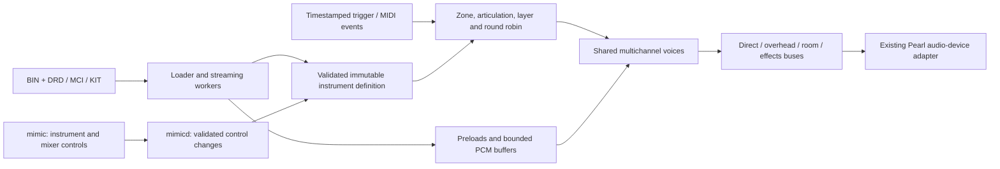

# Mimic instrument library compatibility

The existing libraries can be read without converting them into a different
instrument format. The container, multichannel sample codec, velocity-layer
lookup, round-robin sequence and fixed hi-hat blend table have been recovered
and independently exercised. Complete audible parity with the original
sampler is **not yet established**: event policies, voice rendering and the
saved kit/mixer state are additional parts of the instrument behavior.

This investigation uses the owner's SSD mounted read-only, private local
copies of selected files, and the original application analyzed with
REA/Ghidra. No original library asset, decoded PCM or decompiled proprietary
source is included in Git. The original `mimic_pro` SHA-256 is
`b12895171c9cb8fd7db067c816ba28b4ae4817869a34654175f3e6dfb683fa8c`.

## Format and behavior references

- [Files and metadata](instrument-library-files.md): directory inventory,
  typed storage container, BIN/DRD versus MCI, checksums and version quirks.
- [Sample codec and streaming](library-sample-codec.md): exact compressed
  page layout, scalar counts, preload overlap and channel-safe streaming seams.
- [Playback behavior](library-playback-features.md): layers, round robin,
  hi-hat blends, release envelopes, choking and event-processing evidence.
- [Microphones and mixing](library-microphones.md): channel order, mic fields,
  pan, direct/overhead/room paths, damping and unresolved control semantics.

The inspected catalog comprises 373 instruments, 118 kits, 1,417
articulations, 5,947 velocity-layer tables and 22,287 pool sample entries
across Factory, Tama and eDW libraries. `.lib` is a directory. Older
instruments use a small BIN plus a DRD; newer integrated instruments use MCI.
All 491 metadata containers parsed without errors. This inventory describes
these installed libraries, not every library ever produced for the device.

## What one instrument represents

The hierarchy is:

```text
library directory
  instrument
    ordered microphones -> expanded mono/stereo PCM channel layout
    articulations with IDs, zones/notes and choke/muter/fake attributes
      velocity layers with thresholds, gain limits and release limits
        alternative indices -> shared multichannel sample-pool entries
    sample pool -> raw float preloads + compressed full multichannel recordings
    hi-hat control zones, RMS/envelope data, image and additional metadata
```

The samples are not separate unrelated mic recordings. A pool entry contains
the complete interleaved microphone group for one performance. Selecting a
layer and alternative selects that group once; all microphones retain the
same frame position and playback advance. Stereo room or overhead expands
into two consecutive recorded channels. Separate per-mic volume, pan,
envelopes and bus routing are applied after this common selection.

For a concrete artifact-backed example, `Snare 06 SSD` contains six named
articulations. Its center articulation has these layers:

| Velocity range | Pool sample alternatives |
| --- | --- |
| 0..29 | 16, 17, 18, 19 |
| 30..59 | 12, 13, 14, 15 |
| 60..86 | 8, 9, 10, 11 |
| 87..106 | 4, 5, 6, 7 |
| 107..127 | 0, 1, 2, 3 |

Velocity 64 chooses layer 2; round robin chooses one of pool items 8..11.
Every such item carries the direct mono mic and stereo room together, for
three PCM channels. Rimshot, edge rimshot, side, sidestick and rimclick have
separate articulation definitions. Flattening this into a single WAV per
MIDI note would discard layers, alternatives and mic control.

Layer selection and layer gain are separate operations. The original
interpolates gain within the selected layer and may square its interpolation
fraction. Hi-hat openness has its own two-articulation crossfades. There is
no evidence here that ordinary adjacent velocity layers are crossfaded.

## Integration with Open Mimic

The following design extends the process ownership described in
[application-architecture.md](application-architecture.md). It is an
integration contract; the complete loader, continuous sampler and instrument
UI have not been implemented by this investigation.



The loader should build a typed model off the audio thread: instrument
identity, ordered mic/channel layout, articulation ID lookup, zone/control
maps, layer definitions, pool ranges and all known gain/release fields.
Retain unrecognized metadata rather than dropping it during import. The
Tama `insv` sentinel is a demonstrated reason to validate structure and
capabilities instead of rejecting solely by an assumed instrument version.
Validate every reference and byte range before publishing an instrument.
Keep file offsets and range arithmetic wide enough for the file sizes rather
than inheriting native C++ object offsets as on-disk types. The installed
library occupies about 25 GB, while the validated boot exposes roughly
811 MiB of RAM; only the active kit's bounded preloads and voice streaming
buffers should occupy the audio working set.

`InstrumentSelection` is instantiated per articulation and shares one
`FixedRandomSequence` per instrument. The audio owner advances these states
in event order. An event chooses one take, then creates one multichannel
voice; it never creates independent per-mic round-robin states. Hi-hat
control entries may create two such voices, each with its own articulation
and gain. Note numbers, logical zones, articulation IDs and articulation
array indices must remain distinct types/concepts.

Start playback from the real preload data after the 64-scalar guard. Worker
threads read/decode later pages and preserve partial frames at all seams.
Preloads contain whole compressed pages but often an incomplete PCM frame.
The full compressed record repeats the preload's audio, so the tail begins
at page `nobu`, with the existing scalar/channel cursor retained. A bounded
buffer handoff and explicit underrun behavior are required before enabling
continuous playback. Metadata parsing, zlib, file reads, allocation and
instrument destruction belong outside the audio callback.

Keep the existing JUCE audio-device integration and DSP infrastructure. The
generic [JUCE SamplerSound](https://docs.juce.com/master/classjuce_1_1SamplerSound.html)
loads an audio stream into memory and is documented as a basic sampler;
using it alone would not implement the recovered library/event contract.
A dedicated sampler can render through the existing
[AudioIODeviceCallback](https://docs.juce.com/master/classjuce_1_1AudioIODeviceCallback.html)
and use JUCE buffers/DSP while retaining its own deterministic voice and
streaming state. An [AudioFormatReader](https://docs.juce.com/master/classjuce_1_1AudioFormatReader.html)
adapter could expose decoded samples to offline JUCE tools, but it would not
replace the layer, mic, hi-hat or choke logic. These are design conclusions
from the recovered requirements, not claims that the full sampler exists.

Each voice needs the original sample gain, layer/event gain, mic envelope
bank, shared fractional playback cursor and per-mic output gains. Apply
direct, overhead and room routing separately. Preserve both channels of
stereo mics, including their signs and alignment; do not introduce phase
correction based on a guessed metadata abbreviation. Kits and runtime
mixer controls can override defaults, so importing an instrument alone is
not equivalent to restoring a saved kit.

## Implemented components and evidence

| Component | Implemented or established | Validation boundary |
| --- | --- | --- |
| Metadata reader | Bounded Python reader for BIN, KIT and MCI prefix | 491 real containers; five synthetic reader tests. No production C++ metadata loader yet. |
| Pool/channel layout | Range consistency and mono/stereo expansion | All 373 instrument descriptors; actual audio extracted for four complete instruments. |
| Sample codec | Allocation-free C++17 page decoder and CLI | 159 full pool samples; every serialized preload matches; 32 synthetic widths and 28 real pages match original ARM output exactly. |
| Preload/tail seam | Exact guard/page relationship and scalar cursor contract | All 159 fixture items; 72 end on partial frames. Continuous real-time streaming is not implemented. |
| Velocity lookup | C++17 128-entry map and bounds | Original ARM builder agrees for all distinct layouts across 1,417 articulations/373 instruments, plus synthetic boundary cases. Amplitude interpolation is separate. |
| Round robin | Exact fixed table, shared cursor, queue policy and forced-first advancement | 6,400 selections match isolated original ARM execution. Readiness management remains outside the primitive. |
| Hi-hat blend table | C++17 fixed 100-bin table, gains and retained flags | All 100 entries match isolated original ARM execution for a declared synthetic zone. Full pedal/transition state is separate. |
| Mic mixing/envelopes | Field mapping and static equations documented | 873 mic definitions checked; no full original-versus-replacement mixed render yet. |
| Choke/humanization/swell | Relevant branches and envelope arithmetic documented | Partial static traces; caller policies and full audible behavior remain open. |
| Kit restore/effects/voice stealing | Metadata available, native paths identified | Not complete; these prevent a claim of 100% functional parity. |

Unit tests and emulator comparisons use asset-free fixtures or private local
assets. Emulator runs execute only bounded original ARM functions in isolated
memory; they do not launch the original application or observe a live
sampler. The original ELF and fixture hashes are retained in the reports.
The C++ primitives are built as `mimic-samples`; they do not yet make the
current audio test daemon play instrument libraries.

## Compatibility acceptance criteria

The compatibility target is all original instrument behavior, including
multi-mic, multi-layer and round robin. It requires the following additional
comparisons rather than treating successful extraction as completion:

1. Load every installed instrument and all saved kit slot/mixer overrides;
   preserve unknown fields and handle missing referenced content explicitly.
2. Render every articulation at velocities around each layer boundary and
   compare the selected pool item, event gain and output samples.
3. Exercise repeated/interleaved hits across layers and articulations,
   including load/reset, forced-first and unavailable-sample cases.
4. Compare aligned per-mic output before the mixer, including streaming
   seams, non-unity tuning, release bank selection and muting.
5. Replay recorded hi-hat controller trajectories with tip/shank hits,
   pedal/splash, transitions and closing-tail releases.
6. Compare cymbal choke, snare humanization, swell, polyphony/voice stealing,
   RMS scaling and per-voice processing under their actual enabling policies.
7. Restore kit-level direct/overhead/room/reverb/EQ/dynamics routing and compare
   a full mix at defined parameter settings.
8. Stress disk and CPU deadlines on the Mimic, report underruns, and verify
   that loading or UI changes do not block audio or desynchronize microphones.

The research ledger distinguishes statically recovered behavior, independent
function comparisons and still-open system behavior. Full compatibility can
only be declared after those complete event-to-audio comparisons pass.
